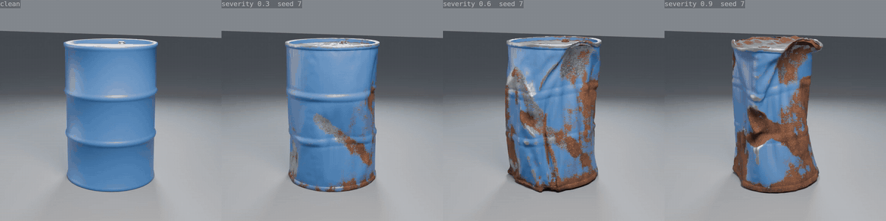

# AnyWreck: clean mesh in, wrecked mesh out

Part of a family: [AnyScene](https://github.com/apekshik/anyscene) builds whole sets,
[AnyKit](https://github.com/apekshik/anykit) builds the props that go in them,
[AnyMachine](https://github.com/apekshik/anymachine) makes machines that move,
[AnyShot](https://github.com/apekshik/anyshot) shoots the result. AnyWreck makes any of it look used.

Give it a clean asset and a severity from 0 to 1. It hands back the same asset dented, crushed and rusted, with the
same UVs and materials, as a new file. Same seed, same wreck.

The most real things are the imperfect ones. A generated or hand-modelled prop comes out factory-new and
symmetrical; this is the step that gives it a life.



**Status: first working version.** Built and tested with Blender 5.2 (set `$BLENDER` to its path); older versions are untested. The explainer video is attached to
the [first release](https://github.com/apekshik/anywreck/releases).

## How it is used

It is a skill, not a service: [SKILL.md](SKILL.md) is the workflow an agent follows.

1. **Understand the object.** The agent looks at the asset and writes a short profile: what it is, which parts are
   thin and which are rigid, how it gets hurt, where it rusts ([profiles/](profiles/)).
2. **Wreck it.** A headless Blender run hits a simulated sheet-metal skin of the asset with real collision objects.
3. **Look, correct the profile, repeat.**
4. **Review video.**

```
blender -b --factory-startup --python pipeline/wreck.py -- --input barrel.glb --output out/barrel/s60.glb \
    --severity 0.6 --seed 7 --profile profiles/oil_barrel.json
```

| parameter | meaning | default |
|---|---|---|
| `--severity` | 0..1. About 0.3 = a few dents; 0.45 and up adds a crush; 0.7 and up adds a bend (if the profile allows) | 0.5 |
| `--seed` | which variant | 0 |
| `--profile` | what the object is and how it wears and breaks | none |
| `--wear` | 0..1 rust and paint wear, separate from the shape damage | = severity |
| `--mode` | `auto`, or any of `dent`, `crush`, `bend` joined with `+` | auto |
| `--hits` | explicit strikes in world units instead of planned ones | |
| `--material` | `thin`, `sheet`, `heavy` | profile, else sheet |
| `--tris` | decimate the result to about this many triangles | keep all |
| `--res` | sheet resolution, cells across the bounding-box diagonal | 110 |
| `--detail` | output edges are split until shorter than diagonal / detail; 0 keeps the input topology | 80 |
| `--object` | for `.blend` input, the object (with children) to wreck | all meshes |

Input `.glb .gltf .obj .fbx .stl .blend`; output by the extension of `--output` (repeatable).

Explicit hits:

```json
[{"type": "dent",  "point": [0.29, 0, 0.5], "dir": [-1, 0, 0], "radius": 0.12, "depth": 0.06, "shape": "ball"},
 {"type": "dent",  "point": [0, 0.29, 0.2], "dir": [0, -1, 0], "radius": 0.02, "depth": 0.04, "shape": "bar", "axis": [0, 0, 1]},
 {"type": "crush", "dir": [-1, 0, 0], "normal": [0.98, 0, 0.17], "depth": 0.15},
 {"type": "bend",  "dir": [0, 1, 0], "at": 0.5, "radius": 0.08, "depth": 0.2}]
```

## How it works

1. All input meshes are copied into one closed, evenly meshed shell (voxel remesh): the sheet.
2. The sheet is simulated in Blender as stiff, nearly inextensible cloth and struck by collision objects: balls and
   bars for dents, a tilted plate for crushing, a bar over two supports for bending. Every 8 frames the deformed
   shape becomes the new rest shape, so it yields and stays bent like metal, and later hits land on earlier damage.
3. Vertices near hard edges of the input (rims, ribs, seams, corners) are several times stiffer, and everything is
   held lightly to its current shape, so only what is forced moves.
4. The original meshes follow the sheet through a Surface Deform binding: UVs, materials and names survive. Long
   edges are split first so there are vertices to show a dent with.
5. Two per-vertex attributes are written (glTF `_DAMAGE`, `_WEAR`): `_damage` = (contact, crease, displacement),
   `_wear` = (rust, grime, edge wear). The surface stage reads these.

Why a simulated sheet and not a procedural dent field: a sheet that cannot stretch cannot just sink inward. It has
to buckle and crease, which is what sheet metal does. Each run's report shows it: surface area stays within a few
percent of the clean asset while the volume drops.

## What it handles

Tested on closed hard-surface props: barrels, gas cylinders, steel crates, lockers, tool carts, fuel tanks, a
generator and a container module (profiles for each are in [profiles/](profiles/)). Thin-walled closed shapes give
the best results; the limits are below.

## Not yet

- **Rust is a mask, not a texture.** Review renders shade it from `_wear`; the exported textures are still the
  clean ones. Baking into colour / normal / ORM is the next step, then decals and growth (moss, barnacles) as a
  second, separately runnable surface stage.
- **No tears or holes.** Nothing rips or breaks off.
- **Open single-sided sheets** are refused: step 1 needs a closed volume.
- **Assemblies of rigid parts** are treated as one skin; small parts smear instead of moving rigidly.
- **Walls can pass through each other** at high severity (self-collision is off: it made the sheet pleat like
  fabric; `DMG_SELFC=1` turns it on).
- Rigs and armatures do not survive.

## Hosting later

`pipeline/wreck.py` is one process: file in, file and JSON report out. [endpoint/server.py](endpoint/server.py) is
a working local HTTP wrapper (127.0.0.1 only) kept as the starting point for a fal app, with the profile step in
front as a vision call. Nothing is deployed.
